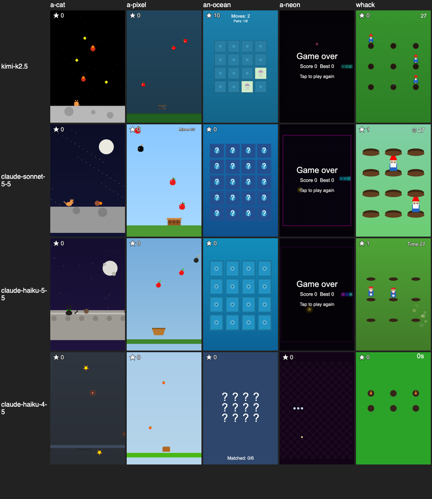

# Maker phase-0 spike

Throwaway code in `apps/maker` that answers four questions before phase 1. Plan: `~/.claude/plans/there-are-models-that-iridescent-wigderson.md`. Run things with:

```bash
pnpm -F maker spike:sdk --model kimi-k2.5          # Q1
pnpm -F maker spike:box --cycles 20                # Q2 + the skill's examples, needs E2B_API_KEY
pnpm -F maker template                             # rebuild the E2B template from image/
pnpm -F maker chat "<prompt>" --model <id> --box local|e2b [--no-images] [--steer "<text>"]
pnpm -F maker eval [--box e2b] [--models a,b]      # Q4: 5 prompts × models, prints the table
```

Keys live in `apps/maker/.env` (see `.env.example`): one Cloudflare AI Gateway token for all models, plus E2B.

## 1. pi-coding-agent SDK

Version 1.2.0 (1.3.0 shipped on the day of the spike; pnpm's minimum release age holds it back). Wrapper: `src/maker.ts`.

**It does what the plan needs**, with these differences from the docs and the plan:

| Plan / docs say | Reality in 1.2.0 |
| --- | --- |
| `noTools: true` | `noTools` is `"all" \| "builtin"`. `"all"` also turns off custom tools; `"builtin"` is the one we want. |
| Skills come from the `resourceLoader` | They load (a standalone `skills/littlejs-api.md` with frontmatter works through `noSkills: true` + `additionalSkillPaths`), but `buildSystemPromptSections` drops the skills list when neither `read` nor `bash` is active, so **the model never sees them**. We add our own `load_skill(name)` tool that lists the skills in its description and returns the Markdown. |
| `importFromJsonl()` restores a session | It is on `AgentSessionRuntime`, not `AgentSession`, takes a file path, copies the file into the session dir and reopens it as a persisted session: it writes files. The in-memory equivalent is `SessionManager.inMemory(cwd, undefined, parseSessionEntries(jsonl))`. `session.exportToJsonl(path)` also only writes a file; the string form is `[header, ...getEntries()]` as JSON lines (`exportJsonl` in `maker.ts`). |
| Default system prompt | Talks about pi's docs and file tools. Replace it with `DefaultResourceLoader({ systemPrompt })`; what's left is our prompt plus a `<cwd>` section (an empty temp dir). |
| Credentials | `ModelRuntime.create({ credentials: new InMemoryCredentialStore(), modelsPath: null })` then `setRuntimeApiKey()`: no `auth.json` / `models.json`. `AuthStorage.inMemory` from the docs isn't exported from the package index. |
| `getModel` from pi-ai | Deprecated; use `getBuiltinModel` from `@earendil-works/pi-ai/providers/all`. |
| Kimi K2.5 via pi-ai | Not in the catalog any more (K2.6, K2.7-code, K3 only). `maker.ts` clones the gateway's Workers AI K2.6 descriptor as `workers-ai/@cf/moonshotai/kimi-k2.5` with Workers AI's K2.5 prices ($0.60 in, $0.10 cached, $3.00 out per M). |

**One key for every model.** All three models go through one Cloudflare AI Gateway: pi-ai's `cloudflare-ai-gateway` provider sends only `cf-aig-authorization: Bearer <CLOUDFLARE_API_KEY>` (it strips `Authorization` / `x-api-key`), so Claude bills to the gateway's Unified Billing credits (5% fee on credit purchases, no markup on tokens) and Kimi K2.5 runs on Workers AI: the same `@cf/moonshotai/kimi-k2.5` the API's Make uses today. Needs `CLOUDFLARE_API_KEY` (AI Gateway Run), `CLOUDFLARE_ACCOUNT_ID`, `CLOUDFLARE_GATEWAY_ID`; the gateway must have authentication on and must not store a `default` BYOK key (that blocks the Unified Billing fallback). It also gives the Maker the gateway's logs and spend limits for free. One exception: the gateway's Unified Billing doesn't cover Haiku 5.5 on its Anthropic route yet (the call reaches Anthropic with no key: 401; Sonnet 5.5, Opus 5.5 and Haiku 4.5 work), so Haiku 5.5 goes to Cloudflare's REST API at `/accounts/<id>/ai/v1/messages` as `anthropic/claude-haiku-5.5` with the same token as a Bearer. That endpoint validates a narrower request than Anthropic's, so `maker.ts` (a) builds Haiku 5.5 from the gateway's model descriptor, not Anthropic's, which would add an empty mid-conversation `{role: "system"}` message (rejected: "messages[1].role"), and (b) rewrites two things in a fetch shim for that URL: it drops the SDK's `?beta=true` and joins the content-block `system` into a string. Thinking, cache control, tool results with images and streaming all pass. Delete both once the gateway bills it.

Evidence so far (no model call needed):

- Requests go to `gateway.ai.cloudflare.com/v1/<account>/<gateway>/anthropic/v1/messages` (Claude) and `…/compat/chat/completions` (Kimi), and the payload's `tools` is exactly `["run_node", "load_skill"]`.
- Active tools: `["run_node", "load_skill"]`; system prompt sections: preamble (ours) + `cwd`.
- After creating a session and appending messages: nothing under `cwd`, the `agentDir` is never created, `~/.pi` is untouched.
- A transcript exported to JSONL (header, model change, thinking level, 2 messages) restores in a **new process** with both messages intact.

Live, on Kimi K2.5 (`pnpm -F maker spike:sdk --model kimi-k2.5`):

- The request's `tools` is exactly `run_node`, `load_skill`; nothing in the system prompt mentions file tools.
- After two prompts with tool calls: nothing under `cwd`, `~/.pi` untouched.
- Exported 9 messages to JSONL, started a **new process**, restored with `SessionManager.inMemory(…, entries)`, asked for the secret word from the first process: `"pumpkin"`.
- `steer()` and `followUp()` called during a `run_node` call both return `"queued"`. The steer lands as a user message right after that tool's result (same run, next turn); the follow-up lands after the agent has nothing left to do; one `prompt()` resolves after both, then `agent_settled` fires. That's the "make it pink" mid-run path, as designed. pi also puts an empty `system` message at the head of `session.messages`.

## 2. Box

`src/box.ts`: `Box { run(code, {timeoutMs}) → {stdout, stderr, exitCode, files}; writeFile; readFile }`.

- `run` writes the code to a temp `.mjs` and runs `node exec.js <file>` in the workspace. `image/exec.js` puts `read`, `write`, `patch(file, old, new)` (throws unless exactly one match), `playtest()` and `minify()` on `globalThis`, then imports the file (top-level await works). `files` = workspace files changed by the run.
- `playtest()` strips game.ts's types with esbuild, inlines `runtime.js` + `game.js` into `preview.html`, serves it to headless Chromium at 360×540 with `GAME_CSP` as a real response header (so `sandbox allow-scripts` applies), aborts every other request, taps and presses arrows for 3 s, then writes `playtest.png` and returns `{ok, errors, warnings, state, score, objects, time}`. `ok` = no console errors and the game clock ran.
- **LocalBox**: temp dir, child process with only `HOME`, `PATH` and the browsers path in its env (test: `src/box.test.ts`). No isolation: spike only.
- **E2BBox**: template `hopon-maker` from `image/build.ts` (node 24, ffmpeg, esbuild, playwright-core 1.58.2 + chromium-headless-shell, `/opt/hopon/{exec,runtime}.js`), built in 73 s. Created with `allowInternetAccess: false`.

Measured (20 cycles, E2B, 2 vCPU / 2 GB, called from a laptop; `src/spike-box.ts`):

|                                            | p50     | p90     | max     |
| ------------------------------------------ | ------- | ------- | ------- |
| `Sandbox.create`                           | 455 ms  | 532 ms  | 573 ms  |
| `pause()`                                  | 323 ms  | 433 ms  | 521 ms  |
| `Sandbox.connect` (resume) + first `run`   | 458 ms  | 587 ms  | 908 ms  |
| `run` again after resume                   | 258 ms  | 357 ms  | 369 ms  |
| first `run` in a fresh box (cold node)     | 1467 ms | 1608 ms | 1807 ms |
| first `playtest()` in a fresh box          | 22.2 s  |         |         |
| next `playtest()` (3 s of it is play time) | 4.4 s   |         |         |

An earlier pass that never ran node before pausing measured resume + first run at p50 3.3 s: the cold-node cost lands on whichever run comes first. The 22 s first playtest is Chromium's cold start; warming it in the template (a start command that launches Chromium once before the snapshot) should move it out of the first turn.

Isolation checks from inside the box:

- `fetch("https://example.com")` fails: the connection hangs until our 5 s timeout (dropped, not refused).
- `process.env` has only `E2B_EVENTS_ADDRESS E2B_SANDBOX E2B_SANDBOX_ID E2B_TEMPLATE_ID HOME LOGNAME PATH PS1 PWD SHELL SHLVL USER _`: no secrets.
- Gotchas: `npm init` now writes `"type": "commonjs"`, so ESM `exec.js` needed `npm pkg set type=module`; the template's `setEnvs` applies to the build but not to `commands.run`, so `exec.js` finds Chromium itself.

## 3. LittleJS skill and runtime

- `skills/littlejs-api.md`: rules (globals only, procedural drawing, portrait 20-unit-wide world, touch first), the hopon scaffold API, the five hooks, math/colour, drawing, `EngineObject`, particles, input, ZzFX `Sound` with starter sounds, how to playtest, and three complete games (flappy, Lights Out puzzle, drag-to-dodge). All three pass `playtest()` in LocalBox and the first in E2B.
- `image/scaffold.js` + `src/runtime.ts` → `image/runtime.js`: LittleJS core in release mode (the engine's own release file list minus all plugins) + the scaffold, minified. The scaffold owns the start screen (title, hint, tap to start), score, game over / win, best score and tap-to-restart, pausing the engine outside play. Games call `hopon.addScore()` and `hopon.gameOver(won)`.

Surprises:

- **LittleJS is no longer ~40 KB.** 1.26.1's `littlejs.min.js` is 474 KB / 147 KB gzipped (3D, box2d, editor). Our core-only runtime is **148 KB / 47 KB gzipped**; their strip-ASSERT step would trim more. Still fine for a cached `/runtime/v1.js`, but the plan's number is off by 3×.
- Today's `GAME_CSP` has `script-src 'unsafe-inline'` only. The plan's `<script src="/runtime/v1.js">` needs `'self'` added. Chromium runs a `'self'` script under `sandbox allow-scripts` (checked); WebKit (iOS WebView) not yet checked.
- LittleJS's globals are `let`s, so they're not on `window`; the scaffold looks hooks up by name, and the playtest reads state by name. A game's `const gameUpdate = …` works too.
- Kimi on Workers AI reasons even with pi's thinking level at "low" (3k–21k output tokens per game) at about 30 tokens/s, so turns take minutes. Once it also typed a CJK comma into code.
- The release build keeps running after a per-frame exception (per engine.js), so a game can look alive while throwing every frame; `playtest()` counts console errors, which catches it.

## 4. Eval

`pnpm -F maker eval --models kimi-k2.5,claude-sonnet-5-5,claude-haiku-5-5,claude-haiku-4-5` (LocalBox, models in parallel, prompts in order). Prompts: the three examples in `apps/mobile/app/create.tsx`, plus "A neon snake game. Swipe to turn, eat the glowing dots, don't bite your own tail." and "Whack-a-mole with garden gnomes: tap them before they duck back down. 30 seconds on the clock." Thinking level "low" for all. "Green" = `playtest()` ok: no console errors and the clock ran.

| model | prompt | 1st playtest green | final green | run_node calls | in / out tokens | $ | s |
| --- | --- | --- | --- | --- | --- | --- | --- |
| kimi-k2.5 | moon cat | yes | yes | 3 | 65,901 / 19,106 | 0.076 | 545 |
| kimi-k2.5 | fruit catcher | yes | yes | 1 | 14,077 / 3,301 | 0.015 | 97 |
| kimi-k2.5 | ocean memory | yes | yes | 1 | 26,871 / 15,940 | 0.053 | 410 |
| kimi-k2.5 | neon snake | no | yes | 5 | 133,366 / 21,174 | 0.082 | 573 |
| kimi-k2.5 | gnome whack | yes | yes | 1 | 25,996 / 16,481 | 0.055 | 486 |
| claude-sonnet-5-5 | moon cat | yes | yes | 1 | 19,200 / 2,102 | 0.048 | 22 |
| claude-sonnet-5-5 | fruit catcher | yes | yes | 2 | 29,990 / 2,595 | 0.057 | 33 |
| claude-sonnet-5-5 | ocean memory | yes | yes | 1 | 19,585 / 2,485 | 0.053 | 28 |
| claude-sonnet-5-5 | neon snake | yes | yes | 1 | 18,913 / 1,952 | 0.046 | 23 |
| claude-sonnet-5-5 | gnome whack | yes | yes | 1 | 18,925 / 1,789 | 0.045 | 24 |
| claude-haiku-4-5 | moon cat | yes | yes | 7 | 103,266 / 7,028 | 0.066 | 108 |
| claude-haiku-4-5 | fruit catcher | yes | yes | 2 | 28,112 / 3,611 | 0.035 | 41 |
| claude-haiku-4-5 | ocean memory | yes | yes | 2 | 28,001 / 3,554 | 0.034 | 45 |
| claude-haiku-4-5 | neon snake | yes | yes | 1 | 17,757 / 2,621 | 0.027 | 26 |
| claude-haiku-4-5 | gnome whack | yes | yes | 2 | 27,024 / 2,480 | 0.027 | 28 |
| claude-haiku-5-5 | moon cat | yes | yes | 3 | 45,359 / 4,530 | 0.004 | 43 |
| claude-haiku-5-5 | fruit catcher | yes | yes | 1 | 19,474 / 2,186 | 0.002 | 19 |
| claude-haiku-5-5 | ocean memory | yes | yes | 1 | 25,199 / 7,942 | 0.006 | 45 |
| claude-haiku-5-5 | neon snake | yes | yes | 2 | 31,443 / 2,886 | 0.003 | 34 |
| claude-haiku-5-5 | gnome whack | yes | yes | 1 | 19,939 / 2,644 | 0.003 | 23 |

| model | 1st green | median run_node calls | $ / game | median s / game | looks (contact sheet) |
| --- | --- | --- | --- | --- | --- |
| Kimi K2.5 (Workers AI) | 4/5 | 1 | 0.056 | 486 | playable, small sprites |
| Sonnet 5.5 | 5/5 | 1 | 0.050 | 24 | best: clear sprites, every prompt reads right |
| Haiku 5.5 (Cloudflare REST)* | 5/5 | 1 | 0.004 | 34 | close to Sonnet: clear sprites, working timer |
| Haiku 4.5 | 5/5 | 2 | 0.038 | 41 | weakest: text-only cards, a broken timer |

\* Haiku 5.5 ran a day later, after the skill's `Timer` fix below, so its gnome game had help the others didn't. Its price is right: $0.10 in / $0.50 out per M up to 100K-token prompts (Anthropic's list price; Unified Billing adds no markup), a tenth of Haiku 4.5's.



- **Every model accepted the screenshot image part** in tool results (no API errors; each describes what's on the screenshot in its reasoning: Kimi 56 times, Haiku 4.5 17, Sonnet 6).
- **Haiku 5.5 goes through Cloudflare's REST API**, not the gateway (see §1). Its OpenAI-style `/ai/v1/chat/completions` is no good for pi either: for Anthropic models it streams Anthropic-format SSE.
- **Green isn't correct.** Haiku's gnome game shows "0s" from the first second (it used `Timer.elapsed()`, a boolean, as seconds) and still passed. Snake games die to random taps within 3 s and pass too. The skill now spells out `Timer` (`-timer.get()` is seconds left).
- Round 1 (Kimi only, before two fixes): the scaffold drew the score at top centre, on top of Kimi's "27s" timer, so the screenshot read "20s"; Kimi spent 13 runs and $0.34 debugging a bug that wasn't there, and hit the 12-run cap. The score now sits top left and the skill says to keep that corner clear. Also, pi's thinking level "off" sends `thinking: {type: "disabled"}`, which Claude 5.5 rejects (it wants `"between_tools"`), so every Sonnet call 400'd until we moved to "low".
- E2B end to end: `pnpm -F maker chat "<neon snake>" --model claude-sonnet-5-5 --box e2b` made the game in 26 s, one run, $0.043, green, with the playtest screenshot taken by Chromium inside the box.

## Recommendation

- **Harness: keep pi-coding-agent.** Everything the Maker needs works: built-in tools off, our two tools only, in-memory transcript exported as JSONL and resumed in another process, `steer()` / `followUp()` mid-run, no files written. Budget for its gaps: our own `load_skill`, our own JSONL string export, and an exact version pin (it shipped 1.0.4 → 1.3.0 in ten days).
- **Box: E2B.** Create ~0.5 s, pause ~0.3 s, resume + first command ~0.5 s, egress dropped, no secrets. Before launch, warm Chromium into the template snapshot: the first playtest in a fresh box takes 22 s, later ones 4.4 s.
- **Engine: LittleJS, no need for Kaplay.** 20 of 20 games were green in the end, and the only first-playtest failure was a Kimi typo (a "、" in code), not an engine API mistake. All four models wrote working LittleJS from the skill alone. The runtime is 148 KB minified / 47 KB gzipped, not the plan's ~40 KB. Add `'self'` to `GAME_CSP` for a served `/runtime/v1.js` and check it on iOS WebKit.
- **Model: Sonnet 5.5 or Haiku 5.5, decided by phase 5; drop Kimi.** Sonnet 5.5 made the best games, fastest (24 s median), at about Kimi's cost per game ($0.050 vs $0.056: Kimi's reasoning output eats its lower token price). Haiku 5.5 came close on looks at **$0.004 a game, a twelfth of Sonnet**, in 34 s; if the 30-prompt eval holds that up, it's the default and Sonnet the "make it better" tier. Kimi K2.5 on Workers AI takes ~8 minutes a game, too slow for a chat, and its reasoning doesn't turn off through the gateway. Haiku 4.5 is out (worst games, 10× Haiku 5.5's price).
- **Before phase 5's 30-prompt eval, make playtest stricter.** Green means "no errors and the clock ran", which every model passes. Let the model script its own inputs (`playtest({ taps: [...] })`), take a start and an end screenshot, and report `state: "over"` within the first seconds as a warning, so the model (and the eval) can tell "died to random taps" from "broken".
